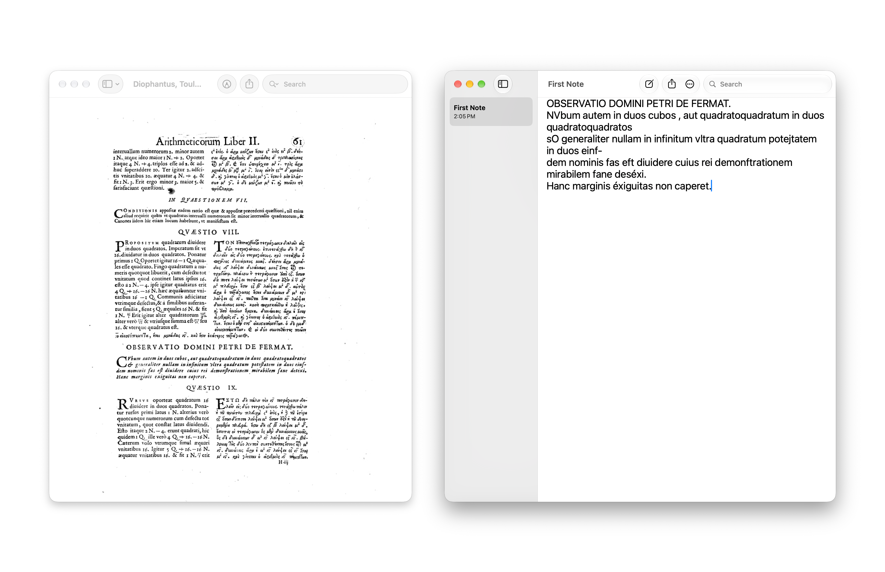

<picture><source media="(prefers-color-scheme: dark)" srcset="docs/icon-github-dark.png"></picture>

# Merum

Plain-text notes for Mac and iPhone. On the Mac a hot key shows them over any app; anything pasted becomes text, and a long note is as quick as a short one.

<picture><source media="(prefers-color-scheme: dark)" srcset="docs/scene.webp"></picture>

Apple silicon, macOS 13 or later; iPhone, iOS 26 or later.

## Install

```sh
brew install geragarazagh/tap/merum
```

Or download [`Merum.dmg`](https://github.com/geragarazagh/merum/releases/latest/download/Merum.dmg).

iPhone: [App Store](https://apps.apple.com/app/id6839201907).
